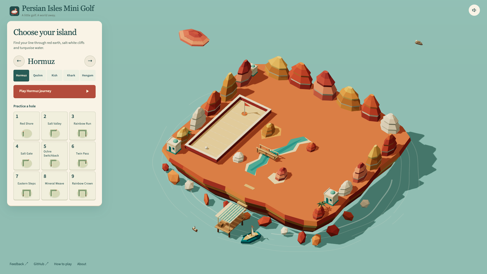
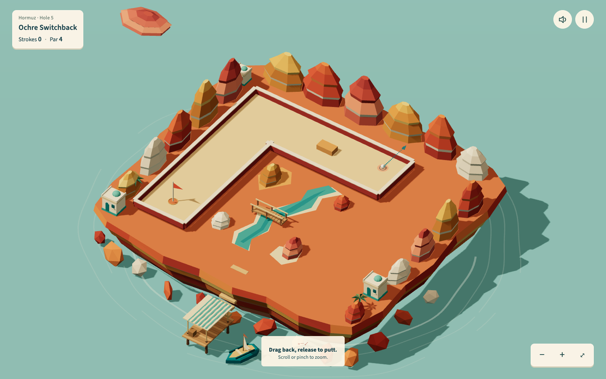

# Persian Isles Mini Golf

**A little golf. A world away.**

A low-poly mini golf browser game inspired by Iran’s Persian Gulf islands. Line up a bank shot between salt-white cliffs, red earth and turquoise water, with WebGL rendering powered by Three.js and ball physics powered by Rapier.

**v0.2.0 contest demo:** nine playable Hormuz holes, with Qeshm, Kish, Khark and Hengam as visual previews only. Acceptance prioritizes loading, controls and completing the journey; physical-phone and first-time-player checks remain unperformed follow-ups, not certification claims. See [validation scope](docs/release-readiness.md).



[Download / Releases](https://github.com/itline/persian-isles-mini-golf/releases/latest) · [Quick start](#quick-start) · [Controls](#controls) · [Changelog](CHANGELOG.md) · [Contributing](CONTRIBUTING.md)

## Play locally

No backend, account or API key is required. The game runs in a WebGL-capable browser and can be hosted as a static website.

### Download a build

1. Open [GitHub Releases](https://github.com/itline/persian-isles-mini-golf/releases/latest) and download the **static build ZIP**. Source archives are available there too; those require the build steps below.
2. Extract the static build ZIP and open a terminal in the extracted folder containing `index.html`.
3. Serve that folder over HTTP:

   ```sh
   python3 -m http.server 8080
   ```

4. Open <http://127.0.0.1:8080/>.

Node.js is not needed to play a prebuilt release. Do not open `index.html` through `file://`; the game requires an HTTP server.

### Quick start

Install Node.js and npm first. **Node.js 24 (LTS line) is recommended.** Supported Node.js versions match the package’s engine range: `^22.12.0 || ^24.0.0 || >=26.0.0` — Node 22.12+ within the 22.x line, 24.x, or 26+.

```sh
git clone https://github.com/itline/persian-isles-mini-golf.git
cd persian-isles-mini-golf
npm ci
npm run dev
```

Open <http://127.0.0.1:4181/>. Keep the development server local; use a production build for public hosting.

### Production build

```sh
npm run build
npm run preview
```

The build is written to `dist/`. Preview uses <http://127.0.0.1:4181/> too, so stop the development server before starting it.

Alternatively, serve the production build directly:

```sh
python3 -m http.server 8080 --directory dist
```

Open <http://127.0.0.1:8080/>. For deployment, upload the **contents** of `dist/` to the root of a static HTTP(S) host, preserving its asset paths and license notices. A production host does not need Node.js.

## Islands and playable holes

The release contains exactly **nine Hormuz holes**. Choose a hole for practice or select **Play Hormuz journey** to play holes 1–9 in sequence and see a combined scorecard. Qeshm, Kish, Khark and Hengam are preview-only scenes, with no playable courses. Existing per-hole Hormuz records are retained; a legacy three-hole journey record does not count as a completed nine-hole journey.

| Island | Available now | Setting |
| --- | --- | --- |
| **Hormuz** | **9 playable holes** | Red shores, salt cliffs and mineral outcrops |
| Qeshm | Visual preview only — not playable | Weathered canyons and sea-carved arches |
| Kish | Visual preview only — not playable | Pale shores, piers and palms |
| Khark | Visual preview only — not playable | Limestone cliffs, a harbour and lighthouse |
| Hengam | Visual preview only — not playable | Rocky coves, a fishing dhow and dolphins |

| Hormuz hole | Par | The line to find |
| --- | --- | --- |
| 1. Red Shore | 2 | A clear lane and a gentle finish |
| 2. Salt Valley | 3 | An open corner or a bank off the salt walls |
| 3. Rainbow Run | 4 | A long turn through mineral outcrops |
| 4. Salt Gate | 4 | Choose a side of the mineral gate |
| 5. Ochre Switchback | 4 | Reverse the bend and divide the crossing |
| 6. Twin Pass | 4 | Pick the near or wider crossing |
| 7. Eastern Steps | 5 | Alternate around the eastern outcrops |
| 8. Mineral Weave | 5 | Weave between offset obstacles |
| 9. Rainbow Crown | 5 | Bring the whole coast together |

The first three holes introduce pace, corners and long turns. Six additional Hormuz layouts complete the nine-hole journey; each hole's name, par and course sketch are shown in the island menu. Completed holes are saved locally so a journey can continue at the next tee; an interrupted hole restarts from its tee.

Completing a journey does **not** unlock unfinished holes or preview islands. These scenes are playful interpretations, not geographic reconstructions or real golf courses.

### Share a local result

Choose **Share result** after a hole or completed journey. Supported browsers open native sharing; otherwise the result and invitation link are copied. If copying is unavailable, selectable text is shown. Cancellation leaves the round unchanged. Scores are explicitly self-reported local results, not server-verified leaderboard entries.

Invitation links select Hormuz and, for an individual result, the same hole from 1–9. Preview islands have no playable invitations. Links never start a round or unlock audio without a user action. No backend, account or Edge service is involved.

## Screenshots

Screenshots below show the v0.2.0 production build. The phone image is browser emulation, not a physical-device certification.

### Desktop gameplay



### Mobile gameplay


## Controls

| Action | Mouse / desktop | Touch / on-screen controls |
| --- | --- | --- |
| Putt | Drag backwards on the scene, then release; a longer drag adds power | Drag backwards on the scene, then release; a longer drag adds power |
| Aim without dragging | Left / right arrow keys | Use the drag direction |
| Adjust shot power | Up / down arrow keys | Adjust the drag distance |
| Shoot without dragging | Space | Release the drag |
| Pause / resume | Escape or the top-right pause button | Top-right pause button, then Resume |
| Zoom | Mouse wheel or **+ / −** in the bottom-right camera bar | Pinch or **+ / −** in the bottom-right camera bar |
| Orbit | Right-drag within the bounded camera angle | — |
| Overview / return | Reset camera framing with **⤢** | Toggle the whole-course overview and close ball-follow view with **⤢** on phones |
| Retry the hole | **Restart** in the pause menu | **Restart** in the pause menu |
| Back to islands | Pause → Back to the coast, or browser Back | Pause → Back to the coast, or browser Back |

Leaving an unfinished round with recorded strokes asks for confirmation and pauses play. **Keep playing** preserves the round and its previous pause state; **Back to islands** discards the current round, not saved best scores. Browser Back from the island menu retains normal browser navigation.

Click or tap the scene to focus it before using keyboard shot controls. Camera movement freezes while dragging a shot, and pinching never fires a putt. Zoom ranges from 1× to 1.85×.

In the island menu, use tabs, navigation arrows or a horizontal swipe on the scene and non-interactive selector areas. Vertical selector scrolling stays native. The footer links to public GitHub feedback, source code, How to play and About. Sound and pause are directly accessible during play; there is no tools drawer. The upper-left round card shows island, hole, strokes and par without a separate lower score card. The existing on-course hints and How to play dialog remain available. Portrait and landscape share the same controls; the portrait island selector can scroll.

## Features

- **Physics-based putting:** Three.js scenes with Rapier rigid-body ball simulation, shot previews, bank shots and per-hole scoring.
- **Practice or journey:** Replay any of the nine Hormuz holes, or follow the nine-hole route with a final scorecard.
- **Local records:** Per-hole and journey best scores persist in the same browser and origin when local storage is available. They are not synced between devices.
- **Original procedural scenery:** Low-poly coastlines, island-specific details and animated sea life, boats and palms; preview islands load on demand.
- **Synthesized coastal audio:** Original WebAudio music and shot/completion effects, with independent music and effects settings saved locally. Audio starts only after a user gesture; saved off choices remain off.
- **Reduced-motion support:** Decorative scenery motion stops when the browser requests reduced motion. Scenery animation also pauses when the game is paused or the tab is hidden.
- **Static, self-contained gameplay:** No account service, database or external game API is needed. The interface is English-only.

## Development and tests

Install dependencies with `npm ci` before running the checks:

```sh
npm test
```

Browser tests use Playwright’s **Chrome channel** (`channel: 'chrome'` in `playwright.config.js`), not the default bundled Chromium. Install Chrome for Playwright if needed:

```sh
npx playwright install chrome
```

Start the development server in **one terminal** and leave it running:

```sh
npm run dev
```

Then run browser checks in a **separate terminal** from the repository root:

```sh
npm run test:e2e
```

The E2E configuration does not start the server automatically. It expects the game at <http://127.0.0.1:4181/>. Additional audio verification is available while that server is running:

```sh
node scripts/verify-audio-render.js
```

The suites cover putting and journey flows, records, input handling, island availability, layout and selected rendering/audio behavior. They are not comprehensive physics, accessibility or device-performance certification. See the [documentation](docs/) and [dependency audit notes](docs/dependency-audit.md) for supporting reports and their scope.

For a frozen local production candidate served separately (default port 4182), `node scripts/verify-production.js` checks nine Hormuz cards, all four preview-only islands, one actual keyboard shot, QA-hook isolation, external requests and bundled notices. Set `GOLF_URL` to the isolated server URL. This smoke check is not a full journey or full-suite pass.

`scripts/capture-candidate.js` captures Hormuz holes 5 and 9 and the Qeshm preview at desktop and emulated mobile viewports. Set `GOLF_URL` and optionally `OUTPUT`; it neither builds nor publishes. Captures are local candidate evidence, not physical-phone validation. Do not build or run against a shared `dist/` while source changes are in progress.

## Credits and inspiration

### Adapted open-source work

[Mini Golf Mania](https://github.com/LCmaster/minigolf) by Luiz Vicente (LCmaster), pinned at commit [`daae96188fe79eaba10b5e92045b45fc407d345c`](https://github.com/LCmaster/minigolf/tree/daae96188fe79eaba10b5e92045b45fc407d345c), supplied the basis for **four adapted technical modules** under `src/vendor/`: `BallController`, `BallWindTrail`, `PhysicsWorld` and `EngineEvents`. These are MIT-licensed, copyright 2023 Luiz Vicente; the complete notice is preserved in [LICENSE.upstream](LICENSE.upstream). This project adapts those modules with its own ball configuration and application code; it is not a wholesale copy of Mini Golf Mania.

Runtime libraries:

- [Three.js](https://github.com/mrdoob/three.js), version 0.155.0 — **MIT**; WebGL rendering.
- [Rapier 3D compatibility build](https://github.com/dimforge/rapier.js), version 0.11.2 — **Apache-2.0**; rigid-body physics.

Full runtime notices ship with the static build. See [third-party notices](public/THIRD_PARTY_NOTICES.txt), [dependency licenses](public/DEPENDENCY_LICENSES.txt) and the [lockfile license inventory](docs/dependency-licenses.json).

### Original work and visual references

The procedural environment, course geometry, interface and synthesized audio were created for this project, except for the identified third-party components. The game runtime uses no downloaded textures, GLB models or music recordings. Source Sans 3 is bundled locally under the SIL Open Font License for interface text; Georgia is retained for display headings. Font loading does not require an external service. See the bundled font license in `public/fonts/`.

Hormuz’s palette draws inspiration from [NASA Earth Observatory — Iran’s Rainbow Island](https://science.nasa.gov/earth/earth-observatory/irans-rainbow-island-147428). This is a nature reference, not an endorsement or a claim that NASA imagery is bundled with the game.

The separate [marketing sources](marketing/) use bundled **DM Sans** and **Libre Caslon Display** fonts under the SIL Open Font License. Their notices are included in [DM Sans OFL](marketing/assets/DMSans-OFL.txt) and [Libre Caslon Display OFL](marketing/assets/LibreCaslonDisplay-OFL.txt). These fonts are not loaded by the game runtime.

## License and brand identity

Original project code and non-brand assets covered by [LICENSE](LICENSE) are released under the **MIT License**. Commercial use, modification and redistribution are allowed under its terms. Third-party components retain their own licenses and attribution requirements.

**Brand identity is separate.** The project logo/brand mark and favicon are excluded from the MIT grant; no trademark license is granted for the project names or itline identity. Independently branded derivatives should use a distinct name and replace the logo/favicon while preserving required legal notices. See [BRANDING.md](BRANDING.md) for the exact policy. Keeping copyright notices does not imply official endorsement.

Maintained by [itline](https://github.com/itline).

## Contributing and project information

Bug reports, reproducible device issues, accessibility improvements and focused code contributions are welcome. For browser or touch issues, include the browser version, device, orientation and steps to reproduce.

- [Contributing guide](CONTRIBUTING.md) — setup, checks and contribution expectations.
- [Issue tracker](https://github.com/itline/persian-isles-mini-golf/issues) — bugs and feature discussions.
- [Security policy](SECURITY.md) — vulnerability reporting; avoid posting sensitive details in public issues.
- [Changelog](CHANGELOG.md) — changes by release.
- [Releases](https://github.com/itline/persian-isles-mini-golf/releases/latest) — downloadable static builds and source.
- [Documentation](docs/) — supporting technical reports and dependency information.

## Known limitations

- Only Hormuz holes 1–9 are playable. Qeshm, Kish, Khark and Hengam are visual previews, not unlockable gameplay; no playable Qeshm module is included.
- No multiplayer, online leaderboard, accounts, daily challenge or authoritative server-side score validation.
- Touch controls and responsive layouts have automated coverage, but real-device mobile compatibility, GPU performance and audio quality are not certified. Browser emulation is not a substitute for testing on physical phones.
- The production build externalizes the identical Rapier WASM and omits unused audition files; a large-JavaScript-chunk warning still remains. The version-specific transform is guarded and requires re-audit on a Rapier upgrade. See [loading measurements and hosting requirements](docs/loading-optimization.md). Real-host startup and low-end-device performance are not certified.
- Automated checks cover selected paths and inputs, not complete accessibility or physics correctness.
- This is a contest demo, not a production service. Exact cross-refresh-rate physics equivalence and exhaustive device certification are outside this release's acceptance scope. GitHub releases are separate from the hosted Edge game; no Edge deployment is included in v0.2.0.
