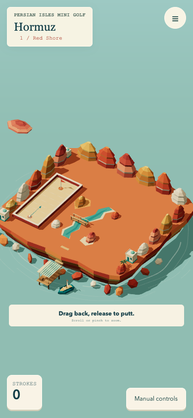

# Persian Isles Mini Golf

**A little golf. A world away.**

A low-poly mini golf browser game inspired by Iran’s Persian Gulf islands. Line up a bank shot between salt-white cliffs, red earth and turquoise water, with WebGL rendering powered by Three.js and ball physics powered by Rapier. Play three holes on Hormuz, or explore four other islands as visual previews.


[Download / Releases](https://github.com/itline/persian-isles-mini-golf/releases/latest) · [Quick start](#quick-start) · [Controls](#controls) · [Changelog](CHANGELOG.md) · [Contributing](CONTRIBUTING.md)

## Play locally

No backend, account or API key is required. The game runs in a WebGL-capable browser and can be hosted as a static website.

### Download a build

1. Open [GitHub Releases](https://github.com/itline/persian-isles-mini-golf/releases/latest) and download the **static build ZIP**. Source archives are available there too; those require the build steps below.
2. Extract the static build ZIP and open a terminal in the extracted folder containing `index.html`.
3. Serve that folder over HTTP:

   ```sh
   python3 -m http.server 8080
   ```

4. Open <http://127.0.0.1:8080/>.

Node.js is not needed to play a prebuilt release. Do not open `index.html` through `file://`; the game requires an HTTP server.

### Quick start

Install Node.js and npm first. **Node.js 24 (LTS line) is recommended.** Supported Node.js versions match the package’s engine range: `^22.12.0 || ^24.0.0 || >=26.0.0` — Node 22.12+ within the 22.x line, 24.x, or 26+.

```sh
git clone https://github.com/itline/persian-isles-mini-golf.git
cd persian-isles-mini-golf
npm ci
npm run dev
```

Open <http://127.0.0.1:4181/>. Keep the development server local; use a production build for public hosting.

### Production build

```sh
npm run build
npm run preview
```

The build is written to `dist/`. Preview uses <http://127.0.0.1:4181/> too, so stop the development server before starting it.

Alternatively, serve the production build directly:

```sh
python3 -m http.server 8080 --directory dist
```

Open <http://127.0.0.1:8080/>. For deployment, upload the **contents** of `dist/` to the root of a static HTTP(S) host, preserving its asset paths and license notices. A production host does not need Node.js.

## Islands and playable holes

Hormuz is the only playable island. Choose a hole for practice or select **Play Hormuz journey** to play all three in sequence and see a combined scorecard.

| Island | Available now | Setting |
| --- | --- | --- |
| **Hormuz** | **3 playable holes**; slots 4–10 are in development | Red shores, salt cliffs and mineral outcrops |
| Qeshm | Visual preview only — not playable | Canyon walls and sea-carved arches |
| Kish | Visual preview only — not playable | Pale shores, piers and palms |
| Khark | Visual preview only — not playable | Limestone cliffs, a harbour and lighthouse |
| Hengam | Visual preview only — not playable | Rocky coves, a fishing dhow and dolphins |

| Hormuz hole | Par | The line to find |
| --- | --- | --- |
| 1. Red Shore | 2 | A clear lane and a gentle finish |
| 2. Salt Valley | 3 | An open corner or a bank off the salt walls |
| 3. Rainbow Run | 4 | A long turn through mineral outcrops |

Completing the journey does **not** unlock the unfinished holes or preview islands. These scenes are playful interpretations, not geographic reconstructions or real golf courses.

## Screenshots

### Desktop gameplay


### Mobile gameplay



## Controls

| Action | Mouse / desktop | Touch / on-screen controls |
| --- | --- | --- |
| Putt | Drag backwards on the scene, then release; a longer drag adds power | Drag and release on the scene, or open **Manual controls** and use aim buttons, the power slider and **Putt** |
| Aim without dragging | Left / right arrow keys | Aim buttons in **Manual controls** |
| Adjust shot power | Up / down arrow keys | Power slider |
| Shoot | Space | **Putt** |
| Pause / resume | Escape or the pause button | Pause / resume controls; on small screens, open the game tools menu |
| Zoom | Mouse wheel or **+ / −** buttons | Pinch or **+ / −** buttons |
| Orbit | Right-drag within the bounded camera angle | Use the overview/reset control to return to the full course |
| Reset camera | Full-course / reset camera button | Full-course / reset camera button |
| Retry the hole | **Restart** | **Restart** |

Click or tap the scene to focus it before using keyboard shot controls. Camera movement freezes while dragging a shot, and pinching never fires a putt. Zoom ranges from 1× to 1.85×.

In the island menu, use tabs, navigation arrows or a horizontal swipe on the scene and non-interactive selector areas. Vertical selector scrolling stays native. The footer links to public GitHub feedback, source code and About; sound settings remain available from the speaker icon. Landscape is recommended on phones; portrait also has a scrollable selector and compact tools menu.

## Features

- **Physics-based putting:** Three.js scenes with Rapier rigid-body ball simulation, shot previews, bank shots and per-hole scoring.
- **Practice or journey:** Replay any available Hormuz hole, or follow the three-hole route with a final scorecard.
- **Local records:** Per-hole and journey best scores persist in the same browser and origin when local storage is available. They are not synced between devices.
- **Original procedural scenery:** Low-poly coastlines, island-specific details and animated sea life, boats and palms; preview islands load on demand.
- **Synthesized coastal audio:** Original WebAudio music and shot/completion effects, with independent music and effects settings saved locally. Audio starts only after a user gesture; saved off choices remain off.
- **Reduced-motion support:** Decorative scenery motion stops when the browser requests reduced motion. Scenery animation also pauses when the game is paused or the tab is hidden.
- **Static, self-contained gameplay:** No account service, database or external game API is needed. The interface is English-only.

## Development and tests

Install dependencies with `npm ci` before running the checks:

```sh
npm test
```

Browser tests use Playwright’s **Chrome channel** (`channel: 'chrome'` in `playwright.config.js`), not the default bundled Chromium. Install Chrome for Playwright if needed:

```sh
npx playwright install chrome
```

Start the development server in **one terminal** and leave it running:

```sh
npm run dev
```

Then run browser checks in a **separate terminal** from the repository root:

```sh
npm run test:e2e
```

The E2E configuration does not start the server automatically. It expects the game at <http://127.0.0.1:4181/>. Additional audio verification is available while that server is running:

```sh
node scripts/verify-audio-render.js
```

The suites cover putting and journey flows, records, input handling, island availability, layout and selected rendering/audio behavior. They are not comprehensive physics, accessibility or device-performance certification. See the [documentation](docs/) and [dependency audit notes](docs/dependency-audit.md) for supporting reports and their scope.

## Credits and inspiration

### Adapted open-source work

[Mini Golf Mania](https://github.com/LCmaster/minigolf) by Luiz Vicente (LCmaster), pinned at commit [`daae96188fe79eaba10b5e92045b45fc407d345c`](https://github.com/LCmaster/minigolf/tree/daae96188fe79eaba10b5e92045b45fc407d345c), supplied the basis for **four adapted technical modules** under `src/vendor/`: `BallController`, `BallWindTrail`, `PhysicsWorld` and `EngineEvents`. These are MIT-licensed, copyright 2023 Luiz Vicente; the complete notice is preserved in [LICENSE.upstream](LICENSE.upstream). This project adapts those modules with its own ball configuration and application code; it is not a wholesale copy of Mini Golf Mania.

Runtime libraries:

- [Three.js](https://github.com/mrdoob/three.js), version 0.155.0 — **MIT**; WebGL rendering.
- [Rapier 3D compatibility build](https://github.com/dimforge/rapier.js), version 0.11.2 — **Apache-2.0**; rigid-body physics.

Full runtime notices ship with the static build. See [third-party notices](public/THIRD_PARTY_NOTICES.txt), [dependency licenses](public/DEPENDENCY_LICENSES.txt) and the [lockfile license inventory](docs/dependency-licenses.json).

### Original work and visual references

The procedural environment, course geometry, interface and synthesized audio were created for this project, except for the identified third-party components. The game runtime uses no downloaded textures, GLB models, music recordings or web fonts.

Hormuz’s palette draws inspiration from [NASA Earth Observatory — Iran’s Rainbow Island](https://science.nasa.gov/earth/earth-observatory/irans-rainbow-island-147428). This is a nature reference, not an endorsement or a claim that NASA imagery is bundled with the game.

The separate [marketing sources](marketing/) use bundled **DM Sans** and **Libre Caslon Display** fonts under the SIL Open Font License. Their notices are included in [DM Sans OFL](marketing/assets/DMSans-OFL.txt) and [Libre Caslon Display OFL](marketing/assets/LibreCaslonDisplay-OFL.txt). These fonts are not loaded by the game runtime.

## License and brand identity

Original project code and non-brand assets covered by [LICENSE](LICENSE) are released under the **MIT License**. Commercial use, modification and redistribution are allowed under its terms. Third-party components retain their own licenses and attribution requirements.

**Brand identity is separate.** The project logo/brand mark and favicon are excluded from the MIT grant; no trademark license is granted for the project names or itline identity. Independently branded derivatives should use a distinct name and replace the logo/favicon while preserving required legal notices. See [BRANDING.md](BRANDING.md) for the exact policy. Keeping copyright notices does not imply official endorsement.

Maintained by [itline](https://github.com/itline).

## Contributing and project information

Bug reports, reproducible device issues, accessibility improvements and focused code contributions are welcome. For browser or touch issues, include the browser version, device, orientation and steps to reproduce.

- [Contributing guide](CONTRIBUTING.md) — setup, checks and contribution expectations.
- [Issue tracker](https://github.com/itline/persian-isles-mini-golf/issues) — bugs and feature discussions.
- [Security policy](SECURITY.md) — vulnerability reporting; avoid posting sensitive details in public issues.
- [Changelog](CHANGELOG.md) — changes by release.
- [Releases](https://github.com/itline/persian-isles-mini-golf/releases/latest) — downloadable static builds and source.
- [Documentation](docs/) — supporting technical reports and dependency information.

## Known limitations

- Only the three Hormuz holes are playable. Hormuz slots 4–10 and all four other islands are unfinished gameplay, not unlockable content.
- No multiplayer, online leaderboard, accounts, daily challenge or authoritative server-side score validation.
- Touch controls and responsive layouts have automated coverage, but real-device mobile compatibility, GPU performance and audio quality are not certified. Browser emulation is not a substitute for testing on physical phones.
- The initial JavaScript/WASM bundle includes Three.js and Rapier and triggers a large-chunk warning. Load time and low-end-device performance still need optimization.
- Automated checks cover selected paths and inputs, not complete accessibility or physics correctness.
